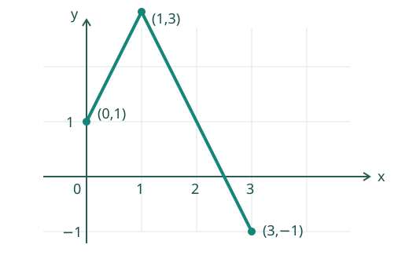

# 下半年毕业考 · 高数II · 2026格式原创模拟

原创教学模拟，非官方试题。种子 delivery-2026；题库 2026.1-ff43f2b3be18；研究 research-c74d105de76e。

15×2分选择＋5×4、5×6、2×10分作答，共100分，全必答。卷一60分钟，卷二120分钟。

## 选择 1 · 第3章 · 2分

多项式\(p(x)=2x^3-x+4\)除以\(x+2\)的余数为何？

A. 10
B. 22
C. −10
D. −14

## 选择 2 · 第23章 · 2分

求\(\int6x(x^2+1)^2\,dx\)。

A. (x²+1)²+C
B. 2(x²+1)³+C
C. (x²+1)³+C
D. 3(x²+1)³+C

## 选择 3 · 第1章 · 2分

点\(P(2,-1)\)到直线\(3x+4y-12=0\)的距离为多少？

A. 10
B. 2
C. −2
D. 2/5

## 选择 4 · 第5章 · 2分

图中折线按所标点顺次连接。在\(x=2\)时，函数值为何？

A. −1
B. 3
C. 1
D. 2

## 选择 5 · 第9章 · 2分

函数\(y=3\sin(4x-\pi/3)+2\)的最小正周期为何？

A. π/4
B. 2π
C. 4π
D. π/2

## 选择 6 · 第14章 · 2分

二阶矩阵\(A\)的行列式为5。把第一行乘3，再交换两行，所得行列式为何？

A. 45
B. −5
C. −15
D. 15

## 选择 7 · 第19章 · 2分

从0、1、2、3、4中无重复地组成三位偶数，共有多少个？

A. 48
B. 30
C. 36
D. 60

## 选择 8 · 第34章 · 2分

\(z=-1-i\)。取主辐角区间\((-\pi,\pi]\)，\(\operatorname{Arg}(z^2)\)为何？

A. −3π/2
B. π/2
C. 3π/4
D. −π/2

## 选择 9 · 第26章 · 2分

独立试验每次成功概率为\(1/4\)，共3次。至少成功一次的概率为何？

A. 3/4
B. 37/64
C. 1/64
D. 27/64

## 选择 10 · 第29章 · 2分

求\(\int xe^x\,dx\)。

A. xe^x+C
B. (x+1)e^x+C
C. x²e^x/2+C
D. (x−1)e^x+C

## 选择 11 · 第16章 · 2分

圆\((x-1)^2+(y+2)^2=25\)在点\((4,2)\)的切线为何？

A. 3x−4y=4
B. 4x+3y=22
C. x+y=6
D. 3x+4y=20

## 选择 12 · 第13章 · 2分

数列前\(n\)项和为\(S_n=3n^2+n\)。第10项为何？

A. 60
B. 58
C. 310
D. 64

## 选择 13 · 第31章 · 2分

以Newton法求\(f(x)=x^3-2x+2=0\)，从\(x_0=0\)出发，\(x_2\)为何？

A. −1
B. 1
C. 0
D. 不存在

## 选择 14 · 第26章 · 2分

两枚独立均匀骰子同时掷出。已知点数和为8，至少一枚为6的条件概率为何？

A. 1/6
B. 1/3
C. 1/5
D. 2/5

## 选择 15 · 第6章 · 2分

若\(x>1\)，以下哪一不等式对所有这样的实数x都成立？

A. x²<2x
B. 1/(x−1)<1
C. x+1/x>2
D. ln x>x−1

## 作答 1 · 第15章 · 4分

用矩阵或消元解\(2u+v=7,\ u-v=2\)，并回代。

## 作答 2 · 第3章 · 4分

多项式p除以\((x-1)(x+2)\)的余式为\(ax+b\)。已知\(p(1)=4,p(-2)=-5\)，求余式。

## 作答 3 · 第1章 · 4分

求直线\(y=2x+1\)与\(y=-x+7\)的交点；再求两线锐夹角的正切。

## 作答 4 · 第17章 · 4分

\(\mathbf a=(t,2),\mathbf b=(3,-6)\)。若两向量垂直，求t及a的长度。

## 作答 5 · 第28章 · 4分

求\(x^2+xy+y^2=7\)在\((2,1)\)的切线，并验证该点在曲线上。

## 作答 6 · 第28章 · 6分

在x>0上\(f(x)=x^x\)。(a)用对数微分求f′；(b)求x=1处切线；(c)证明f在x=e⁻¹达到最小值。

## 作答 7 · 第29章 · 6分

求\(\int\frac{3x+1}{(x-1)(x+1)}dx\)，并说明结果在哪些区间适用。

## 作答 8 · 第10章 · 6分

三角形ABC中AB=5、AC=7、∠A=60°。求BC、面积和外接圆半径，答案保留根号。

## 作答 9 · 第33章 · 6分

椭圆\(x^2/25+y^2/9=1\)。(a)求焦点；(b)求点(3,12/5)处切线；(c)验证该点到两焦点的距离和。

## 作答 10 · 第34章 · 6分

求方程z⁴=−16的全部根，写出极形式及代数形式，并说明根在复平面的位置关系。

## 作答 11 · 第24章 · 10分

区域R由\(y=x^2\)与\(y=4\)及y轴围成，取第一象限部分。(a)求面积；(b)求R绕x轴旋转体积；(c)改绕y轴旋转求体积；(d)比较并解释为何同区域不保证同体积。

## 作答 12 · 第22章 · 10分

\(f_a(x)=x^3-3ax\)，a>0。(a)求两个驻点并分类；(b)若局部极大值与极小值之差为32，求a；(c)用所得a求曲线与x轴围成的总面积。

