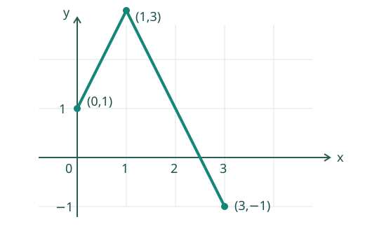

# 预试 · 高数II · 2026格式原创模拟

原创教学模拟，非官方试题。种子 delivery-2026；题库 2026.1-ff43f2b3be18；研究 research-4dfba2689784。

15×2分选择＋5×4、5×6、2×10分作答，共100分，全必答。卷一60分钟，卷二120分钟。

## 选择 1 · 第5章 · 2分

图中折线按所标点顺次连接。在\(x=2\)时，函数值为何？

A. 3
B. 1
C. −1
D. 2

## 选择 2 · 第17章 · 2分

\(\mathbf a=(3,4)\)，\(\mathbf b=(2,0)\)。a在b方向的标量投影为何？

A. 3
B. 5
C. 6
D. 3/2

## 选择 3 · 第18章 · 2分

长方体三条互相垂直的棱长为2、3、6。体对角线长为何？

A. 7
B. 11
C. √41
D. 36

## 选择 4 · 第25章 · 2分

某数据的标准差为4。把每项变换为\(y=3x-7\)，新标准差为何？

A. 5
B. −12
C. 12
D. 37

## 选择 5 · 第9章 · 2分

函数\(y=3\sin(4x-\pi/3)+2\)的最小正周期为何？

A. π/4
B. 2π
C. 4π
D. π/2

## 选择 6 · 第33章 · 2分

抛物线\((y+1)^2=12(x-2)\)的焦点为何？

A. (5,−1)
B. (2,2)
C. (14,−1)
D. (−1,−1)

## 选择 7 · 第15章 · 2分

矩阵\(\begin{pmatrix}t&2\\3&t\end{pmatrix}\)在何条件下可逆？

A. 所有实数t
B. t≠0
C. t≠6
D. t≠±√6

## 选择 8 · 第19章 · 2分

从0、1、2、3、4中无重复地组成三位偶数，共有多少个？

A. 60
B. 36
C. 48
D. 30

## 选择 9 · 第27章 · 2分

已知\(\bar x=2,\bar y=5\)，回归直线斜率为\(3/2\)。截距为何？

A. 5
B. 3/2
C. 2
D. −2

## 选择 10 · 第12章 · 2分

解\(\log_2(x-1)+\log_2(x+1)=3\)。

A. x=−3
B. x=√7
C. x=3
D. x=±3

## 选择 11 · 第29章 · 2分

求\(\int xe^x\,dx\)。

A. (x−1)e^x+C
B. xe^x+C
C. x²e^x/2+C
D. (x+1)e^x+C

## 选择 12 · 第34章 · 2分

\(z=-1-i\)。取主辐角区间\((-\pi,\pi]\)，\(\operatorname{Arg}(z^2)\)为何？

A. 3π/4
B. −π/2
C. π/2
D. −3π/2

## 选择 13 · 第31章 · 2分

以Newton法求\(f(x)=x^3-2x+2=0\)，从\(x_0=0\)出发，\(x_2\)为何？

A. 0
B. 不存在
C. 1
D. −1

## 选择 14 · 第26章 · 2分

两枚独立均匀骰子同时掷出。已知点数和为8，至少一枚为6的条件概率为何？

A. 1/6
B. 1/3
C. 2/5
D. 1/5

## 选择 15 · 第11章 · 2分

在\(0\le x<2\pi\)内，\(2\sin^2x+\sin x-1=0\)共有几个解？

A. 3
B. 1
C. 4
D. 2

## 作答 1 · 第1章 · 4分

求直线\(y=2x+1\)与\(y=-x+7\)的交点；再求两线锐夹角的正切。

## 作答 2 · 第6章 · 4分

解\(\frac{x-2}{x+1}\ge0\)，写出端点是否可取。

## 作答 3 · 第8章 · 4分

一扇形半径r>0，弧度角θ>0。已知弧长为12，面积为36，求r和θ。

## 作答 4 · 第28章 · 4分

求\(x^2+xy+y^2=7\)在\((2,1)\)的切线，并验证该点在曲线上。

## 作答 5 · 第23章 · 4分

曲线的斜率\(y\prime=3x^2-2\)，且经过\((1,4)\)。求曲线方程。

## 作答 6 · 第26章 · 6分

某批零件次品率1/5。一次检验对次品报阳概率9/10，对正品报阳概率1/10。(a)求阳性率；(b)已知阳性求次品概率；(c)若在零件状态给定时两次检验独立，求两次均阳后的次品概率。

## 作答 7 · 第2章 · 6分

\(p(x)=x^2-(t+2)x+2t\)。(a)写出两根；(b)求两个相异正根的t范围；(c)在0<t<2时求两根之积的上确界，并说明是否达到。

## 作答 8 · 第10章 · 6分

三角形ABC中AB=5、AC=7、∠A=60°。求BC、面积和外接圆半径，答案保留根号。

## 作答 9 · 第28章 · 6分

在x>0上\(f(x)=x^x\)。(a)用对数微分求f′；(b)求x=1处切线；(c)证明f在x=e⁻¹达到最小值。

## 作答 10 · 第11章 · 6分

把\(\sin x+\sqrt3\cos x\)写成\(R\sin(x+\alpha)\)，R>0、0<α<π/2；并解该式在0≤x<2π内等于1的全部x。

## 作答 11 · 第31章 · 10分

\(s_n=\sum_{k=1}^n\frac1{k(k+1)}\)。(a)用归纳法证明s_n=n/(n+1)；(b)求s_n>0.99的最小正整数n；(c)令f(x)=x/(x+1)−0.99，写Newton迭代式，并从x0=9求x1；(d)说明为何最小整数答案不能仅由一次迭代读出。

## 作答 12 · 第29章 · 10分

定义\(F(a)=\int_1^a\ln x\,dx\)，a>0。(a)求F；(b)判断F的增减与最小值；(c)解F(a)=1；(d)求\(\lim_{a\to1}F(a)/(a-1)^2\)。

