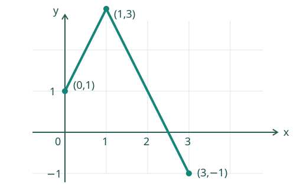

# 上半年校内期末考 · 2026格式原创模拟

原创教学模拟，非官方试题。种子 delivery-2026；题库 2026.1-ff43f2b3be18。

15×2分选择＋5×4、5×6、2×10分作答，共100分，全必答。卷一60分钟，卷二120分钟。

## 选择 1 · 第9章 · 2分

函数\(y=3\sin(4x-\pi/3)+2\)的最小正周期为何？

A. 2π
B. 4π
C. π/4
D. π/2

## 选择 2 · 第5章 · 2分

图中折线按所标点顺次连接。在\(x=2\)时，函数值为何？

A. 2
B. 3
C. −1
D. 1

## 选择 3 · 第33章 · 2分

抛物线\((y+1)^2=12(x-2)\)的焦点为何？

A. (14,−1)
B. (2,2)
C. (−1,−1)
D. (5,−1)

## 选择 4 · 第3章 · 2分

多项式\(p(x)=2x^3-x+4\)除以\(x+2\)的余数为何？

A. 22
B. −14
C. 10
D. −10

## 选择 5 · 第8章 · 2分

半径为6的扇形圆心角为\(2\pi/3\)弧度。弧长为何？

A. 4π
B. 2π
C. 12π
D. 8π

## 选择 6 · 第25章 · 2分

甲组10人的平均分60，乙组15人的平均分80。两组合并平均分为何？

A. 68
B. 70
C. 75
D. 72

## 选择 7 · 第30章 · 2分

微分方程\(y\prime=y(1-y)\)的所有常数解为何？

A. y=0或y=1
B. 没有常数解
C. 仅y=0
D. 仅y=1

## 选择 8 · 第27章 · 2分

已知\(\bar x=2,\bar y=5\)，回归直线斜率为\(3/2\)。截距为何？

A. 3/2
B. −2
C. 2
D. 5

## 选择 9 · 第7章 · 2分

命题“每个实数\(x\)都满足\(x^2>x\)”的否定为何？

A. 存在实数x使x²≤x
B. 每个实数x都满足x²≤x
C. 存在实数x使x²<x
D. 每个实数x都满足x²≥x

## 选择 10 · 第34章 · 2分

\(z=-1-i\)。取主辐角区间\((-\pi,\pi]\)，\(\operatorname{Arg}(z^2)\)为何？

A. −3π/2
B. π/2
C. −π/2
D. 3π/4

## 选择 11 · 第15章 · 2分

矩阵\(\begin{pmatrix}t&2\\3&t\end{pmatrix}\)在何条件下可逆？

A. 所有实数t
B. t≠±√6
C. t≠6
D. t≠0

## 选择 12 · 第35章 · 2分

直线方向\((1,1,0)\)，平面法向\((1,0,0)\)。锐线面夹角为何？

A. 0°
B. 45°
C. 90°
D. 60°

## 选择 13 · 第28章 · 2分

求\(\lim_{x\to0}\frac{e^x-1-x}{x^2}\)。

A. 不存在
B. 0
C. 1
D. 1/2

## 选择 14 · 第26章 · 2分

两枚独立均匀骰子同时掷出。已知点数和为8，至少一枚为6的条件概率为何？

A. 1/6
B. 2/5
C. 1/3
D. 1/5

## 选择 15 · 第31章 · 2分

以Newton法求\(f(x)=x^3-2x+2=0\)，从\(x_0=0\)出发，\(x_2\)为何？

A. 不存在
B. 1
C. 0
D. −1

## 作答 1 · 第3章 · 4分

多项式p除以\((x-1)(x+2)\)的余式为\(ax+b\)。已知\(p(1)=4,p(-2)=-5\)，求余式。

## 作答 2 · 第6章 · 4分

解\(\frac{x-2}{x+1}\ge0\)，写出端点是否可取。

## 作答 3 · 第1章 · 4分

求直线\(y=2x+1\)与\(y=-x+7\)的交点；再求两线锐夹角的正切。

## 作答 4 · 第19章 · 4分

从5位女生、4位男生中选3人委员会，要求至少2位女生。求不同委员会数。

## 作答 5 · 第28章 · 4分

求\(x^2+xy+y^2=7\)在\((2,1)\)的切线，并验证该点在曲线上。

## 作答 6 · 第10章 · 6分

三角形ABC中AB=5、AC=7、∠A=60°。求BC、面积和外接圆半径，答案保留根号。

## 作答 7 · 第16章 · 6分

圆C过(0,0)、(4,0)、(0,6)。(a)求圆方程；(b)求圆在原点的切线；(c)判断点(2,3)的位置。

## 作答 8 · 第29章 · 6分

求\(\int\frac{3x+1}{(x-1)(x+1)}dx\)，并说明结果在哪些区间适用。

## 作答 9 · 第6章 · 6分

解\(\frac{(x-1)(x-4)}{x-2}\ge0\)，并列出0≤x≤5内所有整数解。

## 作答 10 · 第28章 · 6分

在x>0上\(f(x)=x^x\)。(a)用对数微分求f′；(b)求x=1处切线；(c)证明f在x=e⁻¹达到最小值。

## 作答 11 · 第26章 · 10分

盒中3红2蓝，不放回依次抽两球。(a)求两球同色概率；(b)已知至少一红，求两红概率；(c)若改为每次抽后放回，重新求(b)；(d)解释(c)中改变了哪个独立性条件。

## 作答 12 · 第5章 · 10分

\(f(x)=|x-1|+|x+2|\)。(a)写分段式；(b)解f(x)=7；(c)求全域最小值及全部达到点；(d)把f限制到[1,∞)，求反函数及其定义域。

