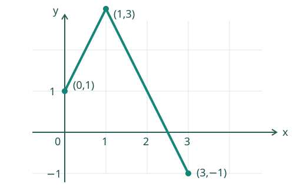

# 统考高级数学（I） · 2026已核实新制全部必答原创模拟

原创教学模拟，非官方试题。种子 delivery-v2；题库 2026.1-e2858b4f1e05；研究 research-ef3497b7731b；热度 heat-6072e482d56f。

选择15×2分，共30分；作答5×4、5×6、2×10共70分，全部必答。卷一60分钟、卷二120分钟。

## 选择 1 · 第5章 · 2分

本题必答。

图中折线按所标点顺次连接。在\(x=2\)时，函数值为何？

A. −1
B. 3
C. 2
D. 1

## 选择 2 · 第8章 · 2分

本题必答。

半径为6的扇形圆心角为\(2\pi/3\)弧度。弧长为何？

A. 12π
B. 4π
C. 8π
D. 2π

## 选择 3 · 第23章 · 2分

本题必答。

求\(\int6x(x^2+1)^2\,dx\)。

A. (x²+1)²+C
B. 3(x²+1)³+C
C. (x²+1)³+C
D. 2(x²+1)³+C

## 选择 4 · 第25章 · 2分

本题必答。

某数据的标准差为4。把每项变换为\(y=3x-7\)，新标准差为何？

A. 37
B. −12
C. 5
D. 12

## 选择 5 · 第18章 · 2分

本题必答。

长方体三条互相垂直的棱长为2、3、6。体对角线长为何？

A. √41
B. 7
C. 11
D. 36

## 选择 6 · 第17章 · 2分

本题必答。

\(\mathbf a=(3,4)\)，\(\mathbf b=(2,0)\)。a在b方向的标量投影为何？

A. 3
B. 5
C. 6
D. 3/2

## 选择 7 · 第4章 · 2分

本题必答。

在\(-1<x<2\)时，化简\(\sqrt{(x-2)^2}+\sqrt{(x+1)^2}\)。

A. 1−2x
B. −3
C. 2x−1
D. 3

## 选择 8 · 第29章 · 2分

本题必答。

求\(\int xe^x\,dx\)。

A. x²e^x/2+C
B. xe^x+C
C. (x+1)e^x+C
D. (x−1)e^x+C

## 选择 9 · 第26章 · 2分

本题必答。

独立试验每次成功概率为\(1/4\)，共3次。至少成功一次的概率为何？

A. 27/64
B. 3/4
C. 37/64
D. 1/64

## 选择 10 · 第16章 · 2分

本题必答。

圆\((x-1)^2+(y+2)^2=25\)在点\((4,2)\)的切线为何？

A. 3x+4y=20
B. x+y=6
C. 4x+3y=22
D. 3x−4y=4

## 选择 11 · 第5章 · 2分

本题必答。

\(f(u)=\ln u\)，\(g(x)=4-x^2\)。\(f\circ g\)的定义域为何？

A. R
B. (−2,2)
C. [−2,2]
D. (−∞,−2)∪(2,∞)

## 选择 12 · 第27章 · 2分

本题必答。

已知\(\bar x=2,\bar y=5\)，回归直线斜率为\(3/2\)。截距为何？

A. −2
B. 5
C. 3/2
D. 2

## 选择 13 · 第6章 · 2分

本题必答。

若\(x>1\)，以下哪一不等式对所有这样的实数x都成立？

A. 1/(x−1)<1
B. ln x>x−1
C. x²<2x
D. x+1/x>2

## 选择 14 · 第2章 · 2分

本题必答。

关于实数\(k\)，方程\(x^2-(k+2)x+2k=0\)有两个相异正实根。下列哪个范围正确？

A. 0<k<2
B. k>2
C. k≥0
D. k>0且k≠2

## 选择 15 · 第22章 · 2分

本题必答。

若\(f\prime(x)=(x-1)^2(x+2)\)，f共有几个局部极值点？

A. 2
B. 1
C. 3
D. 0

## 作答 1 · 第1章 · 4分

本题必答。

求直线\(y=2x+1\)与\(y=-x+7\)的交点；再求两线锐夹角的正切。

## 作答 2 · 第15章 · 4分

本题必答。

用矩阵或消元解\(2u+v=7,\ u-v=2\)，并回代。

## 作答 3 · 第8章 · 4分

本题必答。

一扇形半径r>0，弧度角θ>0。已知弧长为12，面积为36，求r和θ。

## 作答 4 · 第20章 · 4分

本题必答。

将\((1+x)^{-2}\)展开至\(x^2\)项，并写出展开适用范围。

## 作答 5 · 第17章 · 4分

本题必答。

\(\mathbf a=(t,2),\mathbf b=(3,-6)\)。若两向量垂直，求t及a的长度。

## 作答 6 · 第29章 · 6分

本题必答。

求\(\int\frac{3x+1}{(x-1)(x+1)}dx\)，并说明结果在哪些区间适用。

## 作答 7 · 第11章 · 6分

本题必答。

把\(\sin x+\sqrt3\cos x\)写成\(R\sin(x+\alpha)\)，R>0、0<α<π/2；并解该式在0≤x<2π内等于1的全部x。

## 作答 8 · 第26章 · 6分

本题必答。

某批零件次品率1/5。一次检验对次品报阳概率9/10，对正品报阳概率1/10。(a)求阳性率；(b)已知阳性求次品概率；(c)若在零件状态给定时两次检验独立，求两次均阳后的次品概率。

## 作答 9 · 第10章 · 6分

本题必答。

三角形ABC中AB=5、AC=7、∠A=60°。求BC、面积和外接圆半径，答案保留根号。

## 作答 10 · 第24章 · 6分

本题必答。

区域R由\(y=x^2\)与\(y=2x\)围成。(a)求R面积；(b)求R绕x轴旋转一周的体积；解释上下函数选择。

## 作答 11 · 第24章 · 10分

本题必答。

区域R由\(y=x^2\)与\(y=4\)及y轴围成，取第一象限部分。(a)求面积；(b)求R绕x轴旋转体积；(c)改绕y轴旋转求体积；(d)比较并解释为何同区域不保证同体积。

## 作答 12 · 第28章 · 10分

本题必答。

曲线\(x^2+xy+y^2=7\)。(a)证明在点(1,2)附近可将y视为x的可导函数并求y′；(b)求该点切线；(c)求该点二阶导数；(d)据切线估计x=1.02时同一局部分支的y，并判断相对于曲线是偏大还是偏小。

