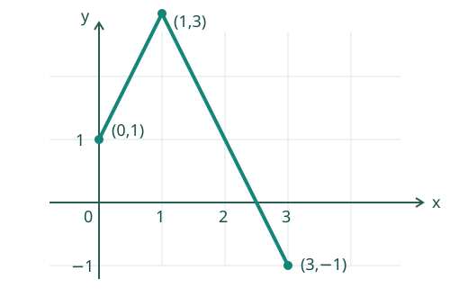

# 统考高级数学（II） · 2026格式原创模拟

原创教学模拟，非官方试题。种子 delivery-2026；题库 2026.1-ff43f2b3be18；研究 research-bb4e7a5b4f14。

15×2分选择＋5×4、5×6、2×10分作答，共100分，全必答。卷一60分钟，卷二120分钟。

## 选择 1 · 第23章 · 2分

求\(\int6x(x^2+1)^2\,dx\)。

A. (x²+1)²+C
B. 3(x²+1)³+C
C. 2(x²+1)³+C
D. (x²+1)³+C

## 选择 2 · 第5章 · 2分

图中折线按所标点顺次连接。在\(x=2\)时，函数值为何？

A. 2
B. 1
C. 3
D. −1

## 选择 3 · 第25章 · 2分

甲组10人的平均分60，乙组15人的平均分80。两组合并平均分为何？

A. 70
B. 75
C. 68
D. 72

## 选择 4 · 第18章 · 2分

长方体三条互相垂直的棱长为2、3、6。体对角线长为何？

A. 11
B. √41
C. 7
D. 36

## 选择 5 · 第9章 · 2分

函数\(y=3\sin(4x-\pi/3)+2\)的最小正周期为何？

A. π/4
B. 4π
C. π/2
D. 2π

## 选择 6 · 第33章 · 2分

抛物线\((y+1)^2=12(x-2)\)的焦点为何？

A. (5,−1)
B. (14,−1)
C. (2,2)
D. (−1,−1)

## 选择 7 · 第29章 · 2分

求\(\int xe^x\,dx\)。

A. x²e^x/2+C
B. (x−1)e^x+C
C. (x+1)e^x+C
D. xe^x+C

## 选择 8 · 第34章 · 2分

\(z=-1-i\)。取主辐角区间\((-\pi,\pi]\)，\(\operatorname{Arg}(z^2)\)为何？

A. 3π/4
B. −π/2
C. π/2
D. −3π/2

## 选择 9 · 第24章 · 2分

连续函数\(f\)满足\(f(x)+f(2-x)=6\)。求\(\int_0^2f(x)dx\)。

A. 无法确定
B. 12
C. 6
D. 3

## 选择 10 · 第35章 · 2分

直线方向\((1,1,0)\)，平面法向\((1,0,0)\)。锐线面夹角为何？

A. 45°
B. 60°
C. 0°
D. 90°

## 选择 11 · 第7章 · 2分

命题“每个实数\(x\)都满足\(x^2>x\)”的否定为何？

A. 每个实数x都满足x²≤x
B. 存在实数x使x²<x
C. 存在实数x使x²≤x
D. 每个实数x都满足x²≥x

## 选择 12 · 第28章 · 2分

曲线\(x^2+xy+y^2=7\)在\((1,2)\)的切线斜率为何？

A. 4/5
B. −1/2
C. −5/4
D. −4/5

## 选择 13 · 第2章 · 2分

关于实数\(k\)，方程\(x^2-(k+2)x+2k=0\)有两个相异正实根。下列哪个范围正确？

A. 0<k<2
B. k>0且k≠2
C. k≥0
D. k>2

## 选择 14 · 第10章 · 2分

三角形中\(A=30^\circ,a=5,b=8\)。满足条件的三角形共有几个？

A. 1
B. 0
C. 2
D. 3

## 选择 15 · 第31章 · 2分

以Newton法求\(f(x)=x^3-2x+2=0\)，从\(x_0=0\)出发，\(x_2\)为何？

A. 1
B. 不存在
C. −1
D. 0

## 作答 1 · 第3章 · 4分

多项式p除以\((x-1)(x+2)\)的余式为\(ax+b\)。已知\(p(1)=4,p(-2)=-5\)，求余式。

## 作答 2 · 第8章 · 4分

一扇形半径r>0，弧度角θ>0。已知弧长为12，面积为36，求r和θ。

## 作答 3 · 第15章 · 4分

用矩阵或消元解\(2u+v=7,\ u-v=2\)，并回代。

## 作答 4 · 第20章 · 4分

将\((1+x)^{-2}\)展开至\(x^2\)项，并写出展开适用范围。

## 作答 5 · 第17章 · 4分

\(\mathbf a=(t,2),\mathbf b=(3,-6)\)。若两向量垂直，求t及a的长度。

## 作答 6 · 第5章 · 6分

\(f(x)=\ln(x-1),\ g(x)=x^2+1\)。(a)求f∘g及其定义域；(b)把g限制在x≥0，求g⁻¹；(c)解释为什么不能在全实数域给g唯一反函数。

## 作答 7 · 第10章 · 6分

三角形ABC中AB=5、AC=7、∠A=60°。求BC、面积和外接圆半径，答案保留根号。

## 作答 8 · 第24章 · 6分

区域R由\(y=x^2\)与\(y=2x\)围成。(a)求R面积；(b)求R绕x轴旋转一周的体积；解释上下函数选择。

## 作答 9 · 第6章 · 6分

解\(\frac{(x-1)(x-4)}{x-2}\ge0\)，并列出0≤x≤5内所有整数解。

## 作答 10 · 第30章 · 6分

样品质量满足dm/dt=−km，k>0，t以小时计。m(0)=80克，6小时后剩40克。(a)求模型；(b)何时剩10克？

## 作答 11 · 第29章 · 10分

定义\(F(a)=\int_1^a\ln x\,dx\)，a>0。(a)求F；(b)判断F的增减与最小值；(c)解F(a)=1；(d)求\(\lim_{a\to1}F(a)/(a-1)^2\)。

## 作答 12 · 第33章 · 10分

抛物线\(y=x^2\)，点P=(0,2)。(a)求抛物线上点到P距离平方的表达式；(b)求最短距离及所有最近点；(c)以P为圆心的圆与抛物线相交于4个不同点，求半径r范围。

