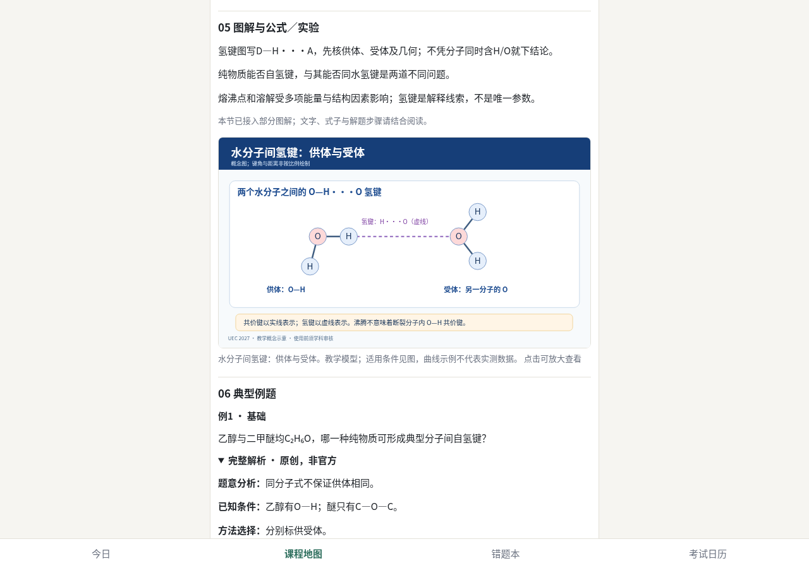

# V22 插图接入交付

已恢复原工作区、原分支 `codex/uec-v22-illustrations` 及未提交成果，从PR1已合并的main基线 `ce2f44b8cae16aba750ab9c696807599c39f2a5c` 继续。本轮重新执行检查，未将上一轮统计截图当作验证证据。只提交到一个以main为目标的Draft PR，不合并、不部署。

149张输入：物理57、化学33、生物59。逐图状态为 **PASS 111、FIXED 36、BLOCKED 2**。PASS/FIXED表示本报告记录的可用范围，不是教师或官方全面审定。

实际教学页面接入 **71张不同SVG、12章、40个真实小节**；另22张为同题材备选，54张知识点已识别但真实小节未确认，2张结构隔离。接入图中53张PASS、18张FIXED。所有上传原件与原有正确教学图文件保留。

36张修订中，12张仅处理标题栏重复标签的排版，其余24张有条件、科学关系或局部版面修正。逐项原/新哈希与修复理由见 [149图审查](ASSET_REVIEW.md) / [JSON](ASSET_REVIEW.json) / [CSV](ASSET_REVIEW.csv)。本次没有调用AI生图。

## 接入范围

|现有章节|真实小节|接入图数|
|---|---|---|
|生物3|3.2、3.4、3.5、3.6、3.7|19|
|物理3|3.5、3.8、3.4、3.6、3.9、3.7|9|
|物理4|4.2、4.3、4.7、4.8、4.6|10|
|化学7|7.1.2、7.1.1、7.2.1、7.2.2、7.3.1|10|
|化学8|8.2.1、8.1、8.4.1、8.4.2、8.2.2、8.3|7|
|化学4|4.2.3|1|
|化学9|9.1.2、9.2、9.3|3|
|化学10|10.1.2、10.3|3|
|化学11|11.2、11.3|3|
|化学5|5.4|1|
|生物2|2.2、2.5、2.3|4|
|生物1|1.6|1|

完整40节名称、对应图码与位置见 [接入清单](INTEGRATED_SECTIONS.md)。内部图码如C27–C34只是审核简称，不是新课程章号；包内唯一ID不变。M04/M05/M06分别贴近相关概念、推导/实验与补充图解例，图中数值与原笔记例题分别计算。

## 原142项任务及真实缺口

**完整覆盖3项、部分44项、没有V22对应95项**，逐项保留 [覆盖表](TASK_COVERAGE.md)。完整3项是位置图斜率、光反应/循环交换（由互补图合计满足）、卡尔文循环。没有将149张文件等同于142项完成。

原142项实际含118项独立图片任务和24项HTML/CSS关系图任务。95项无V22对应含71项独立图任务及24项原内联任务；原内联实现保留，不因缺V22而要求另外画一张，也未重新扩大其科学验收范围。115项独立图任务仍未由V22完整满足（含44项部分覆盖），不能写成缺139张图。

[具体未满足要求](MISSING_TASKS.md)及[完整JSON](MISSING_TASKS.json)保留原任务的独立中英文Prompt、Negative Prompt、对象、公式、单位、科学关系和验收标准。原始142项Prompt JSON逐字节保留。

## 修图、隔离与映射

重点修复斜面法向力与正交分量、第三定律受力对象、落地后轨迹、ATP条件、光合指标、实验等体积对照、主动运输梯度、氢键几何、氯气冷稀碱条件、感应电动势/电流区别、蒸发位置及文字遮挡。147个可用版本全部重新渲染并检查文字边界。

B39线粒体内膜不连续、B41保卫细胞结构不可靠，仍隔离；[具体修图规范及中英Prompt](QUARANTINE_AND_REPAIR.md)。既有5张错误P0的隔离不变。

54张待映射图在审查JSON中列出现有章级候选、知识点与所缺的真实小节证据，不编造编号。例如现有物理4.6正文明确把冲量留给第8章，因此P10不能塞进4.6；P29动能平方关系则有4.6正文依据。数学I/II入口、独立记录及35章兼容资料未迁移。

19组重复题材及8个旧图展示替代路径均在 [统计](SUMMARY.json) 登记；只是选择页面展示版本，没有删除旧文件。B01/B33保留内容更完整的原图展示。

## 验证与阅读效果

重新通过149原件与147可用版本哈希、137个课程/笔记/资源基线文件逐字节保护、55个数值样本、17条原子/电荷配平，以及SVG端点向量、水分子角度与膜运输梯度验证。116章框架、86个已保存小节和1032模块保持。

V22通过36组320/390/1280视窗与章节检查、142次逐图放大/滚动/Esc/焦点回归、149个资源渲染。全站42组及旧专项9/15/15组回归另通过，覆盖进度、掌握、错题、日历、题库、备份恢复和I/II隔离。测试环境为headless Chromium的视窗模拟，没有声称iOS/Android真机测试。

手机缩略图用于整体理解，细小标签需要点击放大并横向滚动；放大图最小1200px，页面本身无横向溢出。科学图保留白底和原科学颜色，深色模式图题随网站主题。未重新设计全站。

[完整测试记录](TEST_RESULTS.md) · [来源和核实边界](SOURCES.md) · [149图接触表索引](VISUAL_PAGES.json)

## 实际教学页面截图

[物理电脑](screenshots/P16-1280-light.png) · [物理手机](screenshots/P16-390-light.png) · [化学电脑](screenshots/C17-1280-light.png) · [化学手机](screenshots/C17-390-light.png) · [生物电脑](screenshots/B22-1280-light.png) · [生物手机深色](screenshots/B22-390-dark.png) · [手机放大后的主动运输](screenshots/zoom-B22-390-active.png)

未完成：2张结构重绘、54张真实小节确认、22张备选的后续复用及原任务缺口。科学教师复核与2027官方适用性没有因工程测试通过而自动完成。
